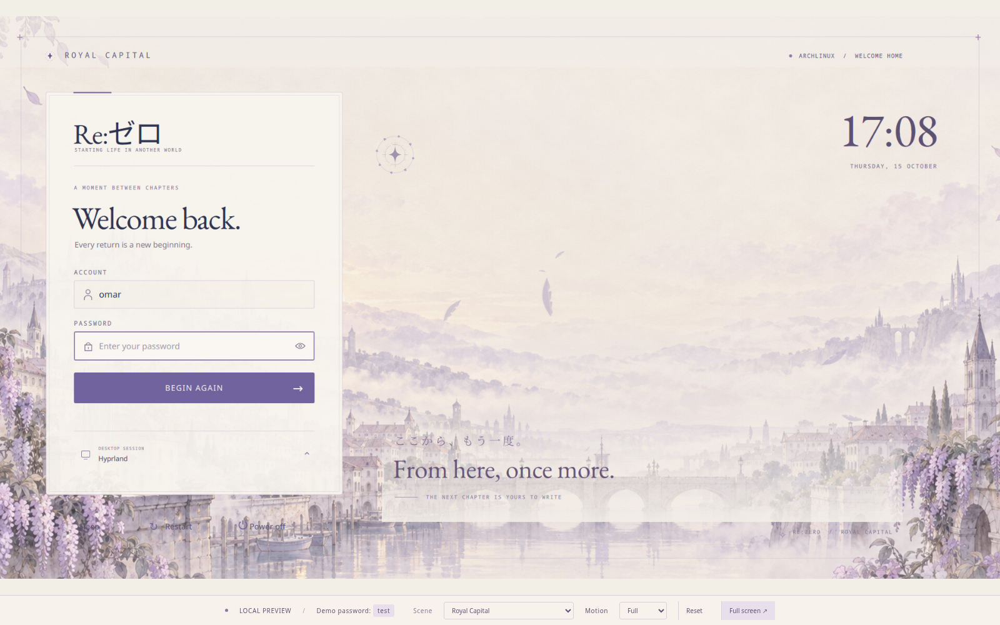

# Re:Zero — Royal Capital

An animated **Qt 6 SDDM login theme** in warm ivory, lavender, and muted purple. Royal Capital is the default scene; Subaru and Emilia alternatives are included.



## Install as your login screen

Requires Linux, Qt 6 SDDM, and an installed desktop session. On Arch Linux:

```sh
sudo pacman -S --needed git python sddm qt6-declarative qt6-svg noto-fonts-cjk
git clone https://github.com/MrTr4p/rezero-royal-capital-sddm.git
cd rezero-royal-capital-sddm
python scripts/install.py --check
```

Preview the actual greeter before installation:

```sh
QT_QPA_PLATFORM=xcb QT_QUICK_CONTROLS_STYLE=Basic QSG_RHI_BACKEND=opengl \
  sddm-greeter-qt6 --test-mode --theme "$PWD/theme"
```

Close the test window with **Ctrl+C** in the launching terminal. Test mode does not authenticate or start a desktop. Then install and select the theme:

```sh
sudo python scripts/install.py
```

The installer copies `theme/` into `/usr/share/sddm/themes/rezero-royal-capital`, verifies the copies, and selects it using `/etc/sddm.conf.d/99-rezero-royal-capital.conf`. The installed theme does not depend on the checkout or the browser preview. It preserves a backup and leaves the running display manager and desktop session alone.

**Reboot when you are ready** to use the new login screen. Sign in with your normal Linux username and password. SDDM must already be your enabled display manager; the installer does not change display-manager services, autologin, or desktop sessions.

If preflight reports a conflicting `Current` or `ThemeDir` in `/etc/sddm.conf` or a later snippet, resolve that setting before installing. The legacy `/etc/sddm.conf` takes precedence over snippets.

## Scenes and animation

| Scene | Artwork and behavior | `Background` |
| --- | --- | --- |
| **Royal Capital** · default | Misty city, drifting feathers, camera movement | `assets/royal-capital.png` |
| A Promise at Dawn | Subaru + Emilia, petals, mist, gentle garment/hair sway | `assets/subaru-promise.png` |
| Return by Death | Subaru, clock rings, particles that rewind after a failed login | `assets/subaru-rewind.png` |
| Sanctuary | Emilia in a quiet garden | `assets/sanctuary.png` |
| Original artwork | Emilia and Subaru above the city | `assets/background.png` |
| Moonlit Forest | Pale forest landscape | `assets/moonlit-forest.png` |

Edit the installed `theme.conf`:

```ini
[General]
Background=assets/royal-capital.png
PreferredSession=hyprland.desktop
Animations=true
MotionLevel=full
HairSway=false
```

`MotionLevel` accepts `full`, `gentle`, or `still`. `Animations=false` also stops motion. The Subaru scenes use a dedicated shader with faces pinned; software rendering keeps camera, mist, clock, and particle animation but displays still character artwork. `HairSway` controls the older portrait shader and should remain false for landscapes and Sanctuary.

The session menu reads the installed sessions. If the preferred session is unavailable, it falls back to the remembered/first session. With no available sessions, authentication is blocked.

## Controls

- **Enter:** sign in. **Escape:** clear the password. **Tab:** move through controls.
- Password visibility button and Caps Lock indicator.
- Sleep, Restart, and Power off confirmations, respecting SDDM capabilities.
- Failed login clears the password and restores focus; Return by Death briefly reverses its animation. The real clock continues to show the correct time.
- Successful login fades into the welcome transition.

## Optional localhost preview

The browser shows the native QML scene running in an isolated virtual display. Its mock backend never authenticates against Linux, starts a desktop, or executes power commands.

Additional Arch dependencies:

```sh
sudo pacman -S --needed base-devel pkgconf qt6-base qt6-shadertools mesa \
  xorg-server-xvfb x11vnc python-pip
python -m venv "$HOME/.local/share/rezero-sddm/venv"
"$HOME/.local/share/rezero-sddm/venv/bin/pip" install -r preview/requirements.txt
./start.sh
```

Open **http://localhost:8771/**. The demo password is **`test`**; any other nonempty password shows the retry animation. The toolbar selects a scene and Full/Gentle/Still motion, resets the demo, or enters fullscreen. Preview selections last for the service session and do not change the installed SDDM theme.

```sh
./stop.sh
```

The transient `rezero-sanctuary-preview.service` does not start at boot. HTTP `8771`, WebSocket `6071`, and VNC `5971` bind only to loopback; the virtual display is `:171`. Logs are under ignored `runtime/` and in `journalctl --user -u rezero-sanctuary-preview.service`.

`REZERO_X11VNC` and `REZERO_WEBSOCKIFY_PYTHON` can point to custom executables before running `./start.sh`. The launcher also supports the earlier local preview tool cache.

## Update and rollback

Pull changes, then rerun the installer. It replaces the installed `theme.conf`, so retain any custom settings before updating. Every install creates a timestamped backup below `/var/lib/sddm/theme-backups/rezero-royal-capital/` and prints its path.

Restore the previous theme selection with that exact backup path:

```sh
sudo python scripts/install.py --restore /var/lib/sddm/theme-backups/rezero-royal-capital/<timestamp>
```

Rollback restores only this theme and its selection snippet, preserves other configuration, and retains the removed theme copy. Reboot when ready. If the graphical login is unavailable, switch to a TTY with **Ctrl+Alt+F3**, log in, and run the restore command there.

## Development and verification

```sh
./preview/test.sh
python scripts/test-install.py
```

Native tests cover validation, password visibility, Enter/Escape, retries, session selection, duplicate submissions, mock power confirmations, three display sizes, and animation timing, rewind, and reduced motion. They use a fake authentication backend.

Browser QA requires Playwright and Chromium, with the preview already running:

```sh
PLAYWRIGHT_MODULE=/absolute/path/to/playwright \
  node preview/check-browser.cjs
```

Omit `PLAYWRIGHT_MODULE` if Playwright is available through normal Node resolution. Set `CHROMIUM_EXECUTABLE` for a Chromium path other than `/usr/bin/chromium`. Screenshots and results go into ignored `validation/`.

## Credits

Original theme/integration code is MIT-licensed. Fonts and noVNC retain their own licenses; see [third-party notices](THIRD_PARTY_NOTICES.md). Artwork is AI-generated, with prompts and provenance in `docs/`. This is an unofficial Re:Zero fan theme.
